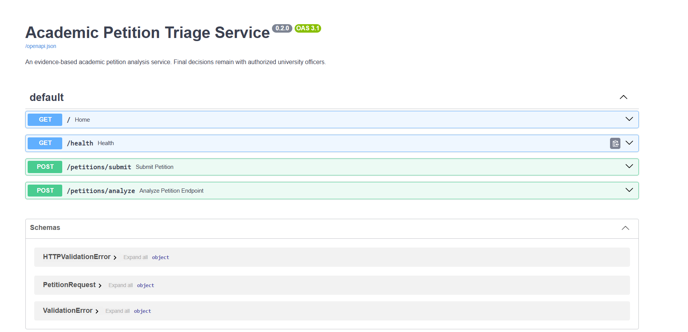
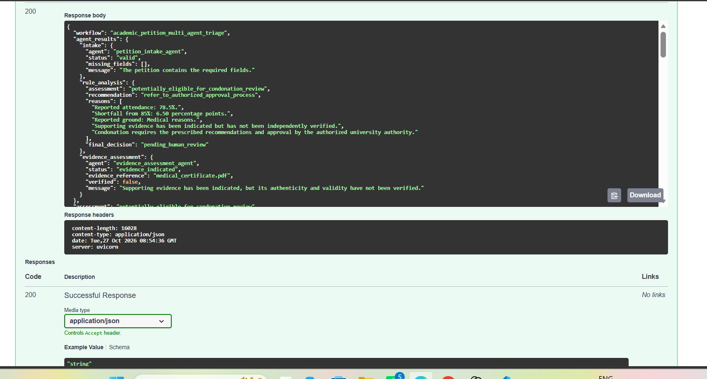
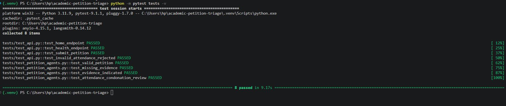
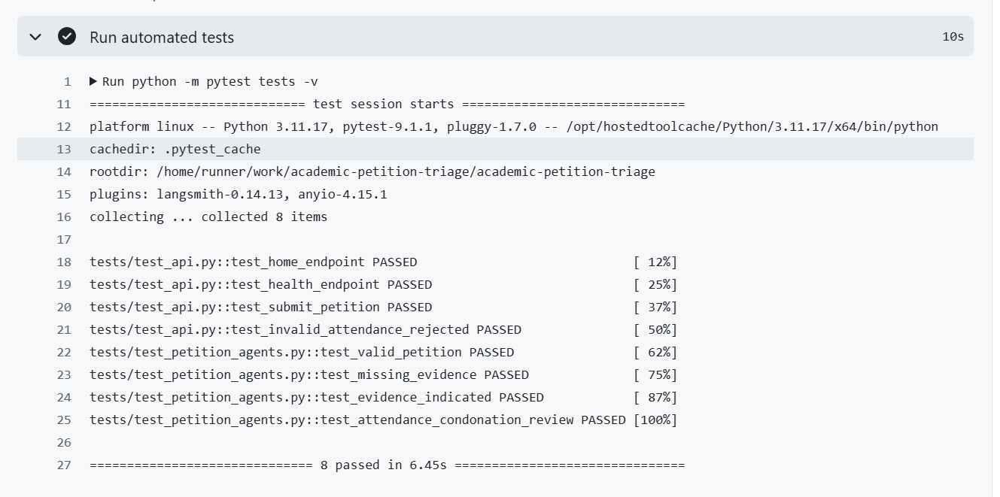

# Academic Regulation and Student Petition Triage Service

An evidence-based academic petition triage service that helps assess student petitions against university regulations using semantic search, rule analysis, evidence assessment, and a multi-agent workflow.

The system retrieves relevant regulatory passages and produces a structured preliminary assessment to support authorized university officers. It does not make final approval or rejection decisions. All official decisions remain subject to human review.

---

## Table of Contents

* [Project Overview](#project-overview)
* [Problem Statement](#problem-statement)
* [Objectives](#objectives)
* [Key Features](#key-features)
* [System Architecture](#system-architecture)
* [System Workflow](#system-workflow)
* [Technology Stack](#technology-stack)
* [Project Structure](#project-structure)
* [Prerequisites](#prerequisites)
* [Installation and Setup](#installation-and-setup)
* [Running with Docker](#running-with-docker)
* [API Documentation](#api-documentation)
* [Example Petition Request](#example-petition-request)
* [Understanding the Output](#understanding-the-output)
* [Automated Testing](#automated-testing)
* [Continuous Integration with GitHub Actions](#continuous-integration-with-github-actions)
* [Monitoring and Logging](#monitoring-and-logging)
* [Screenshots](#screenshots)
* [Limitations](#limitations)
* [Future Enhancements](#future-enhancements)
* [Ethical Considerations](#ethical-considerations)
* [Author](#author)
* [Disclaimer](#disclaimer)

---

## Project Overview

Academic institutions receive petitions from students for various academic circumstances, including attendance shortages, medical issues, and requests for regulatory exceptions.

Manually reviewing each petition against lengthy academic regulations can be time-consuming. Reviewers must identify relevant clauses, check eligibility conditions, examine supporting evidence, and determine the appropriate approval process.

The **Academic Regulation and Student Petition Triage Service** helps organize this process by retrieving relevant regulation passages and generating a structured preliminary assessment.

The application combines semantic regulation retrieval, rule analysis, evidence assessment, and a coordinated triage workflow. It exposes these capabilities through a REST API built with FastAPI.

### Project Scope

The current implementation focuses on academic petition triage, particularly supported attendance-condonation scenarios using the available regulation corpus and implemented rules.

The system is designed to assist human reviewers rather than replace authorized university decision-makers.

---

## Problem Statement

Academic petitions must be assessed against institutional regulations and the circumstances described by students.

Manual assessment can involve:

* Locating relevant regulatory clauses.
* Checking attendance requirements.
* Identifying applicable condonation conditions.
* Examining the grounds stated in a petition.
* Determining whether supporting evidence has been indicated.
* Preparing a structured summary for human review.

The proposed system uses semantic retrieval and a multi-agent workflow to help organize these tasks and provide regulatory context for preliminary assessment.

---

## Objectives

1. Accept and validate academic petition information.
2. Retrieve relevant university regulation passages using semantic similarity.
3. Analyze petition details against supported academic rules.
4. Identify potentially applicable condonation grounds.
5. Assess whether supporting evidence has been indicated.
6. Generate a structured preliminary assessment.
7. Provide recommendations for the appropriate review process.
8. Record monitoring events for petition-analysis operations.
9. Support reproducible testing and containerized deployment.
10. Preserve human oversight for all official decisions.

---

## Key Features

### 1. Petition Intake and Validation

The API accepts petition information, including:

* Student identifier.
* Petition type.
* Semester.
* Reason for the petition.
* Attendance percentage, when applicable.
* Supporting evidence information.

Pydantic validates the request fields and rejects invalid values that violate the schema.

### 2. Semantic Regulation Search

The application processes the available regulation document into text chunks and retrieves passages relevant to a submitted petition.

The retrieval service uses:

* Sentence Transformers for text embeddings.
* `sentence-transformers/all-MiniLM-L6-v2` as the embedding model.
* FAISS for similarity-based retrieval.
* Regulation source, page, and chunk metadata to identify retrieved passages.

The retrieved passages provide regulatory context for the preliminary assessment.

### 3. Rule Analysis

The rule-analysis component evaluates petition details against the rules implemented in the application.

For supported attendance-condonation scenarios, it can consider:

* The submitted attendance percentage.
* The attendance requirement found in the regulation.
* The reason stated in the petition.
* Potentially applicable condonation grounds.
* Relevant regulatory passages.
* Whether further review is necessary.

The current implementation uses deterministic Python logic for supported rule-analysis scenarios.

### 4. Evidence Assessment

The evidence-assessment component considers the supporting evidence information supplied with a petition.

The system distinguishes between evidence being indicated and evidence being verified.

A medical certificate mentioned in a petition is not automatically considered authentic or verified.

### 5. Multi-Agent Triage Workflow

The application organizes petition processing into separate components:

* Petition Intake Agent.
* Rule Analysis Agent.
* Evidence Assessment Agent.
* Triage Coordinator.

These components help organize the petition information, regulatory findings, evidence status, and preliminary recommendation into a structured assessment.

The workflow should not be interpreted as a system of independently operating autonomous AI agents or an official university decision-making system.

### 6. Human Review

The service preserves a human-review requirement.

It can help authorized reviewers understand the relevant regulation, petition circumstances, evidence status, and suggested next steps.

The system does not officially approve or reject petitions.

### 7. Monitoring and Logging

The application records petition-analysis events, including processing status and selected assessment details.

These records help developers inspect execution and investigate problems during testing.

### 8. Docker Support

The project includes a Dockerfile and Docker Compose configuration for running the application in a containerized environment.

---

## System Architecture

```text
+--------------------------------+
|        Student / Client        |
+--------------------------------+
                |
                v
+--------------------------------+
|           FastAPI API          |
|       Request Validation       |
+--------------------------------+
                |
                v
+--------------------------------+
|      Petition Intake Agent     |
+--------------------------------+
                |
                v
+--------------------------------+
|  Semantic Regulation Retrieval |
|                                |
|  Sentence Transformers         |
|  FAISS Similarity Search       |
|  Regulation Text and Metadata  |
+--------------------------------+
                |
                v
+--------------------------------+
|       Rule Analysis Agent      |
+--------------------------------+
                |
                v
+--------------------------------+
|    Evidence Assessment Agent   |
+--------------------------------+
                |
                v
+--------------------------------+
|       Triage Coordinator       |
+--------------------------------+
                |
                v
+--------------------------------+
|    Structured Triage Report    |
+--------------------------------+
                |
                v
+--------------------------------+
|    Authorized Human Review     |
+--------------------------------+

Monitoring Service records analysis events.
```

The diagram represents the logical processing flow. The components work within the implemented application, and the final decision remains with an authorized human reviewer.

---

## System Workflow

The following sequence illustrates how a petition is processed.

```text
1. Student submits a petition
             |
             v
2. API validates the request
             |
             v
3. Petition Intake Agent processes
   the submitted information
             |
             v
4. Semantic search retrieves
   relevant regulation passages
             |
             v
5. Rule Analysis Agent examines
   supported regulatory conditions
             |
             v
6. Evidence Assessment Agent
   assesses indicated evidence
             |
             v
7. Triage Coordinator organizes
   the preliminary assessment
             |
             v
8. API returns a structured report
             |
             v
9. Authorized human review
```

The result is a preliminary assessment, not an official university decision.

---

## Technology Stack

| Technology            | Purpose                                 |
| --------------------- | --------------------------------------- |
| Python                | Main programming language               |
| FastAPI               | REST API development                    |
| Pydantic              | Request validation and schemas          |
| Sentence Transformers | Text embedding generation               |
| `all-MiniLM-L6-v2`    | Semantic embedding model                |
| FAISS                 | Similarity-based vector retrieval       |
| LangGraph             | Workflow-related dependency             |
| PyPDF                 | PDF text extraction                     |
| Docker                | Application containerization            |
| Docker Compose        | Container startup and configuration     |
| Pytest                | Automated testing                       |
| Python logging        | Monitoring and event logging            |
| Git and GitHub        | Version control and source-code hosting |
| GitHub Actions        | Automated testing workflow              |

The table describes the technologies used or configured by the project. A listed dependency should not be interpreted as proof that every possible feature of that technology has been implemented.

---

## Project Structure

```text
academic-petition-triage/
│
├── .github/
│   └── workflows/
│       └── tests.yml
│
├── app/
│   ├── agents/
│   │   ├── evidence_assessment_agent.py
│   │   ├── petition_intake_agent.py
│   │   ├── rule_analysis_agent.py
│   │   └── triage_coordinator_agent.py
│   │
│   ├── api/
│   ├── evaluation/
│   ├── ingestion/
│   │   └── ingest_regulations.py
│   │
│   ├── schemas/
│   │   └── petition.py
│   │
│   ├── services/
│   │   ├── monitoring_service.py
│   │   ├── petition_service.py
│   │   └── regulation_search.py
│   │
│   ├── tools/
│   └── main.py
│
├── corpus/
│   ├── processed/
│   │   ├── regulation_chunks.json
│   │   └── regulation_metadata.json
│   │
│   └── regulations/
│       └── vtu_2025_regulations.pdf
│
├── tests/
│   ├── test_api.py
│   └── test_petition_agents.py
│
├── screenshots/
│   ├── swagger-ui.png
│   ├── petition-analysis.png
│   ├── test-results.png
│   └── github-actions.png
│
├── .dockerignore
├── .env.example
├── .gitignore
├── Dockerfile
├── docker-compose.yml
├── requirements.txt
└── README.md
```

The `screenshots/` directory and the listed image files are intended for project documentation. Create the directory and add the actual images before expecting them to appear in the README.

---

## Prerequisites

Install the following software before running the project:

* Python 3.11 or a compatible Python version.
* Git.
* Docker Desktop with Docker Compose support, if using Docker.
* Internet access on the first run if the embedding model needs to be downloaded.

The first startup may take longer because the application may need to download the embedding model and generate embeddings for the regulation corpus.

---

## Installation and Setup

### Option 1: Run Locally with Python

#### Step 1: Clone the repository

```powershell
git clone https://github.com/bhavyagowdak14/academic-petition-triage.git
cd academic-petition-triage
```

#### Step 2: Create a virtual environment

```powershell
python -m venv .venv
```

#### Step 3: Activate the virtual environment

```powershell
.venv\Scripts\Activate
```

#### Step 4: Install dependencies

```powershell
python -m pip install --upgrade pip
pip install -r requirements.txt
```

#### Step 5: Start the API

```powershell
uvicorn app.main:app --host 127.0.0.1 --port 8000
```

After successful startup, open:

* API base: `http://127.0.0.1:8000`
* Interactive documentation: `http://127.0.0.1:8000/docs`
* Health check: `http://127.0.0.1:8000/health`

These addresses assume the API starts successfully and port 8000 is available.

---

## Running with Docker

Docker provides a consistent environment for running the application.

### Build and start the application

From the project root, run:

```powershell
docker compose up --build -d
```

### Check the running container

```powershell
docker compose ps
```

### View application logs

```powershell
docker compose logs -f petition-api
```

### Stop the application

```powershell
docker compose down
```

The Docker Compose configuration uses persistent volumes for application logs and the Hugging Face model cache.

### Access the application

After successful startup, open:

* API documentation: `http://127.0.0.1:8000/docs`
* Health endpoint: `http://127.0.0.1:8000/health`

The embedding model may be downloaded during the first startup. Subsequent startups can reuse the cached model while the cache volume is retained.

---

## API Documentation

FastAPI provides interactive API documentation through Swagger UI.

Open:

**http://127.0.0.1:8000/docs**

### Available endpoints

| Method | Endpoint             | Purpose                               |
| ------ | -------------------- | ------------------------------------- |
| `GET`  | `/`                  | Returns the application home response |
| `GET`  | `/health`            | Checks application health             |
| `POST` | `/petitions/submit`  | Accepts a petition submission         |
| `POST` | `/petitions/analyze` | Analyzes a submitted petition         |

The exact response structure and behavior are defined by the implementation in `app/main.py` and the associated service modules.

### How to test an endpoint

1. Start the application.
2. Open `http://127.0.0.1:8000/docs`.
3. Expand `POST /petitions/analyze`.
4. Click **Try it out**.
5. Enter the example JSON below.
6. Click **Execute**.
7. Inspect the returned response.

---

## Example Petition Request

The following request demonstrates an attendance-condonation petition.

```json
{
  "student_id": "STU002",
  "petition_type": "Attendance Condonation",
  "semester": 3,
  "reason": "I was unable to attend classes due to a medical condition and request consideration under the applicable university regulations.",
  "attendance_percentage": 78.5,
  "supporting_evidence": "Medical certificate indicated; verification pending"
}
```

This is fictional demonstration data. Use synthetic data in public examples and screenshots rather than real student information.

### Input validation

The current petition schema validates the following fields:

| Field                   | Validation                                  |
| ----------------------- | ------------------------------------------- |
| `student_id`            | Required, non-empty string                  |
| `petition_type`         | Required, non-empty string                  |
| `semester`              | Required integer from 1 to 12               |
| `reason`                | Required string with at least 10 characters |
| `attendance_percentage` | Optional number from 0 to 100               |
| `supporting_evidence`   | Optional string                             |

These checks validate the request structure; they do not independently establish that a petition satisfies university regulations.

---

## Understanding the Output

For a supported attendance-condonation scenario, a preliminary assessment may identify the petition as potentially eligible for further review and recommend referral to the authorized approval process.

The output may include information such as:

| Information           | Meaning                                                    |
| --------------------- | ---------------------------------------------------------- |
| Assessment            | Preliminary classification against implemented rules       |
| Recommendation        | Suggested next step in the review process                  |
| Retrieved evidence    | Regulation passages relevant to the petition               |
| Evidence status       | Whether supporting evidence has been indicated or verified |
| Human review required | Whether an authorized person must review the case          |
| Final decision        | The official outcome, which remains pending human review   |

The exact field names and values depend on the actual API response.

**A preliminary assessment is not a guarantee of eligibility or approval.** Supporting documents are not authenticated merely because their presence is indicated in the request.

---

## Automated Testing

The project includes automated tests for API behavior and petition-agent logic.

### Run the tests locally

Activate the virtual environment and execute:

```powershell
python -m pytest tests -v
```

### Test coverage

The test suite includes tests for:

* Home endpoint.
* Health endpoint.
* Petition submission.
* Invalid attendance rejection.
* Valid petition processing.
* Missing supporting evidence.
* Indicated supporting evidence.
* Attendance-condonation review.

### Recorded test result

The project previously passed **8 automated tests** in a local test run.

Run the command again after making changes to confirm the current result.

---

## Continuous Integration with GitHub Actions

This project uses GitHub Actions to automate testing.

The workflow is defined in:

```text
.github/workflows/tests.yml
```

### How it works

When a commit is pushed to the repository or a pull request is opened or updated, GitHub Actions:

1. Checks out the repository.
2. Sets up Python 3.11.
3. Installs dependencies from `requirements.txt`.
4. Runs the automated tests using Pytest.
5. Reports whether the workflow succeeded or failed.

### Workflow status

The initial GitHub Actions workflow run completed successfully.

View workflow runs here:

[**GitHub Actions — Python Tests**](https://github.com/bhavyagowdak14/academic-petition-triage/actions)

A successful workflow indicates that the configured job completed successfully. Check the individual job logs to confirm the test command and test results.

---

## Monitoring and Logging

The application includes a monitoring service that records petition-analysis events.

Example log information can include:

* Timestamp.
* Event name.
* Petition identifier.
* Processing status.
* Assessment summary.
* Number of retrieved regulation passages.

### Log location in Docker

```text
/app/logs/petition_monitoring.log
```

### Inspect the monitoring log

```powershell
docker compose exec petition-api sh -c "cat /app/logs/petition_monitoring.log"
```

### View container logs

```powershell
docker compose logs petition-api
```

Monitoring logs are useful for development and testing. They should not be considered a complete production audit system.

Avoid storing unnecessary student-identifying information in logs, especially in shared or public deployments.

---

## Screenshots

The following screenshots demonstrate the running application and its testing setup.

**Add your actual screenshots to the `screenshots/` directory using the filenames below.** These image links will not display until the files exist in the repository.

### 1. API Documentation

Shows the FastAPI Swagger UI and available endpoints.



### 2. Petition Analysis

Shows a sample petition request and the actual JSON response returned by the API.



### 3. Local Automated Test Results

Shows the terminal output after running the Pytest suite.



### 4. GitHub Actions

Shows the successful Python Tests workflow in GitHub Actions.



---

## Limitations

The current implementation has the following limitations:

1. **Regulation coverage:** The assessment depends on the documents included in the regulation corpus and the rules implemented in the application.
2. **Rule coverage:** The current rule analysis focuses on supported scenarios and is not a comprehensive implementation of every university regulation.
3. **Evidence verification:** The service does not independently authenticate medical certificates or other supporting documents.
4. **Retrieval quality:** Semantic search can retrieve related passages without necessarily resolving every regulatory condition.
5. **Input dependence:** Incomplete or incorrect petition information can affect the preliminary assessment.
6. **Human oversight:** The system does not make official university approval or rejection decisions.
7. **Production readiness:** Authentication, authorization, privacy controls, deployment security, and more comprehensive operational monitoring would require further development.

---

## Future Enhancements

Potential future improvements include:

* Extending regulation coverage to additional petition categories.
* Adding a user interface for submitting and tracking petitions.
* Introducing authenticated student and administrator access.
* Evaluating retrieval quality against a curated set of relevant clauses.
* Adding expert-reviewed test cases for regulatory analysis.
* Evaluating assessment accuracy and consistency.
* Improving supporting-document handling and verification workflows.
* Adding stronger privacy and access controls.
* Introducing role-based access and secure audit trails.
* Expanding automated testing through GitHub Actions.
* Improving model and index caching for performance.
* Collecting reviewer feedback to support systematic evaluation.

These are proposed enhancements, not claims about functionality that is already implemented.

---

## Ethical Considerations

Academic petitions may affect a student's academic progression. Therefore, the system is designed to support review rather than replace authorized decision-makers.

The project follows these principles:

* **Human oversight:** Official decisions remain with authorized university officers.
* **Transparency:** Relevant retrieved regulation passages can support the preliminary assessment.
* **Evidence integrity:** Indicated evidence must not be treated as authenticated evidence.
* **Responsible use:** Preliminary assessments must not be presented as official university decisions.
* **Privacy:** Student information should be protected, and public demonstrations should use fictional data.
* **Regulatory accuracy:** Institutional rules and their effective dates should be verified before relying on an assessment.

---

## Author

**Bhavya Gowda K.**

GitHub: [@bhavyagowdak14](https://github.com/bhavyagowdak14)

Project repository: [Academic Regulation and Student Petition Triage Service](https://github.com/bhavyagowdak14/academic-petition-triage)

---

## Disclaimer

This project is an academic prototype intended for educational and demonstration purposes.

It provides preliminary petition triage and regulatory information retrieval. It is not an official university decision-making system. Its output must not be treated as a substitute for current institutional regulations or review by an authorized university officer.
